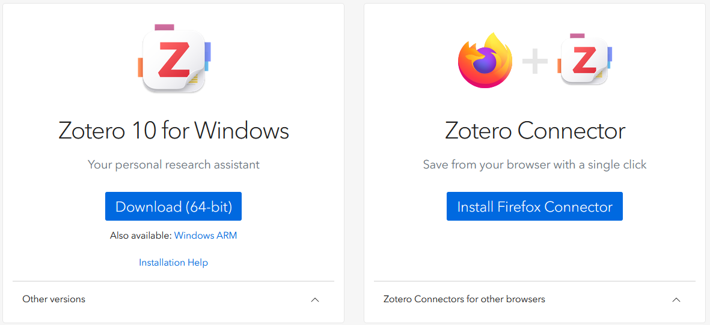
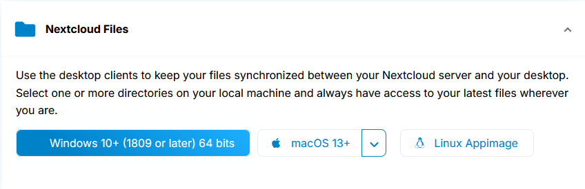

## Welcome

Welcome! Today, I will show you the software we are using, explain how to set everything up, and guide you through coding your first meta-analytic data point.

## Introduction

<iframe class="slide-deck" src="slides/01-intro.html" allowfullscreen>

</iframe>

<a class="pdf-button" href="slides/01-intro.html?print-pdf" target="_blank"><i class="bi bi-file-earmark-pdf"></i> Download PDF</a>

## Part 1: Software

### Zotero

Zotero is a **reference manager**. We will use it to manage all of the references to the relevant measure. The references within it are part of our **research data**.

#### Creating an account

1.  Open the invite link I sent you.
2.  Create an account using your Tilburg University email (initial.lastname{at}tilburguniversity.edu).

#### Downloading the app

1.  Click [here](https://www.zotero.org/download/) to download the app.

    Here you can see the following image:

    {width="500"}

2.  If you have a Windows laptop, click the **Download (64-bit)** button. If you have a MacBook, click **Other versions** and then **macOS**.

3.  **Install the Zotero Connector** (it might say *Install Chrome Connector*) depending on the browser you are using.

#### How to use Zotero?

<iframe class="slide-deck" src="slides/02-zotero.html" allowfullscreen>

</iframe>

<a class="pdf-button" href="slides/02-zotero.html?print-pdf" target="_blank"><i class="bi bi-file-earmark-pdf"></i> Download PDF</a>

### Nextcloud

Nextcloud is a **collaboration platform.** We use it through a cloud storage service. Nextcloud ensures our data is properly synced, so that **all changes** can be tracked and visible.

#### Logging in

1.  Open the invite link I sent you, and I will walk you through it.

#### Downloading the app

1.  Click [here](https://nextcloud.com/install/#desktop-files) to download the app.

    On the right you should be able to see this.{width="500"}

2.  If you have a Windows laptop, click **Windows 10+,** if not click **macOS 13+**.

    If you have a different version let me know.

### Teams

We will use Teams for communication, since it is managed by the university and should be free.

You should, in theory, be able to use it by logging in with your university email at this [link](https://login.microsoftonline.com/common/oauth2/v2.0/authorize?client_id=5e3ce6c0-2b1f-4285-8d4b-75ee78787346&scope=openId%20profile%20openid%20offline_access&redirect_uri=https%3A%2F%2Fteams.cloud.microsoft%2Fv2%2Fauthv2&client-request-id=01a15f8d-be59-7097-a309-09c10e6f6f50&response_mode=fragment&client_info=1&clidata=1&prompt=select_account&nonce=01a15f8d-be59-7660-bd5e-0efe0630e193&state=eyJpZCI6IjAxYTE1ZjhkLWJlNTktNzQyNy05MWY5LTdkZjA4N2EyNDEwOSIsIm1ldGEiOnsiaW50ZXJhY3Rpb25UeXBlIjoicmVkaXJlY3QifX0%3D%7Chttps%3A%2F%2Fteams.cloud.microsoft%2F%3Fenablemcasfort21%3Dtrue&x-client-SKU=msal.js.browser&x-client-VER=5.6.3&response_type=code&code_challenge=33aWDpCQFM3FdU_qOEoy8OCF7JRTSsX_M2EQruKNCPI&code_challenge_method=S256).

## Part 2: Documentation

When working on this project, you need several documents ready at all times. The protocols described in them **have to be followed at all times**.

### Codebook

A meta-analysis codebook is a reference manual: it **defines every variable and specifies the rules for coding it**. Coders use it to extract information from primary studies, such as effect sizes, sample characteristics, and design features, into a structured dataset.

Without a rigorous codebook, it would be **difficult to** **replicate the study** since papers do not always follow the same reporting standards.Therefore, **it is necessary to adhere to the codebook** in order to extract the values as accurately as possible.

The codebook is this file:

> codebook_mwq.xlsx

### Coding sheet

This is the document where you will **enter the values you extract**. It already lists your assigned papers and the variables to code for each.

For each student, the document is in the form of an Excel spread sheet, titled:

> coding-\[first_initial\]\[last_initial\].xlsx

### Coding instructions

These are the instructions you need to follow when coding papers. They specify what to do in some common situations. This document is likely to get updated if something new comes up, so even if you learn it well, you need to **check it out**.

The document is titled:

> coding_instructions.md

### Other

The following webpages are needed when you need to specify languages of papers, languages of scales they used, and the country in which the study was conducted.

The most common language is English, and if a paper is in English you have to type in "en". This is a **standardized code** for the English language. However, an English language study might be conducted in the Netherlands, which uses a **country code** of "nl". For that reason, it is important that you open the two websites that allow you to quickly look up codes for languages and countries (these are not always the same since English is not only spoken in England, for example).

I would suggest opening them at the very beginning of your coding session.

#### Language codes

They can be found at this link: [language codes](https://en.wikipedia.org/wiki/List_of_ISO_639_language_codes)

#### Country codes

They can be found at this link: [country codes](https://en.wikipedia.org/wiki/List_of_ISO_3166_country_codes)

## Part 3: Start coding!

1.  Open the documentation listed above.
2.  Code the **first two papers** of your spreadsheet.
    1.  Find each paper using the **key** column. You can copy-paste this key into the Zotero search bar.
    2.  First scan each paper for language and the type of paper. Make sure to follow the coding instructions.
3.  Good luck!

### Some tips

- It is good to **first check the language of the paper**, since we do not code studies that are not in English.

- It is good to then **check the tags in Zotero**. Some papers cite the questionnaire, but do not use it - and I tagged those as no-new-data in case I have noticed it previously.

- It is good to **search the name of the questionnaire in the paper (ctrl+f)**. This often tells you why they cited the paper. E.g., if they only mentioned it, but they did not use it - the paper is only mentioned once, and does not have new values in it. Search both the full name and the abbreviation.

- It is also good to **search the name of the original author** (maybe they did not name the questionnaire, but did use it). Below is the citation of the paper that introduces the questionnaire.

  > Mrazek, M. D., Phillips, D. T., Franklin, M. S., Broadway, J. M., & Schooler, J. W. (2013). Young and restless: validation of the Mind-Wandering Questionnaire (MWQ) reveals disruptive impact of mind-wandering for youth. *Frontiers in Psychology, 4,* Article 560. [https://doi.org/10.3389/fpsyg.2013.00560](https://psycnet.apa.org/doi/10.3389/fpsyg.2013.00560)

These tips help you filter out papers that we do not need to code.

Finally, my final tip (or a command) is: [**DO NOT READ THE PAPERS!**]{.underline} **Only scan them for information.** *Reading them takes too long, it is cognitively draining, and unhelpful for this task.*
