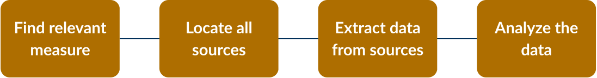
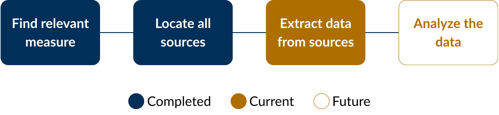
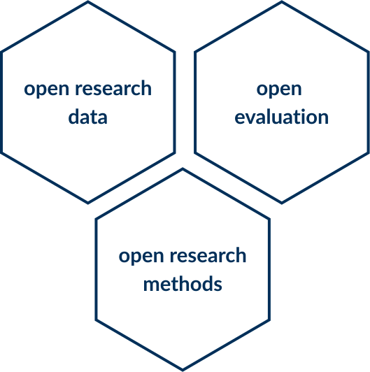

## The project

Have self-reported attentional abilities changed in the internet age?

- Do people report **more** difficulties with focusing across time?

But... we cannot ask them about this retroactively.

Instead, we will **analyze previously collected data.**

## How do we do that?

We have to gather the data!

 

{fig-align="center" width="500"}

## How do we do that?

This is where **you** jump in.

 

{fig-align="center" width="500"}

## What does it mean to extract data?

Every paper that uses a measure reports the values they get after participants complete the measure.

For example:

- average reaction time
- number of correct answers
- average score on a questionnaire

Your task will be to **find these values** and **input them in a spreadsheet**.

## How do I do this?

Like in every instance of data collection, you need to **follow strict protocols**.

Today we will go over these protocols!

## Why protocols?

:::::: columns
::: {.column width="30%"}

:::

::: {.column width="5%"}
:::

::: {.column width="65%"}
In theory... meta-analyses should be a gold standard in research.

But...

- meta-analyses often cannot be reproduced

Facilitating **reproducible** and **responsible** research.
:::
::::::
